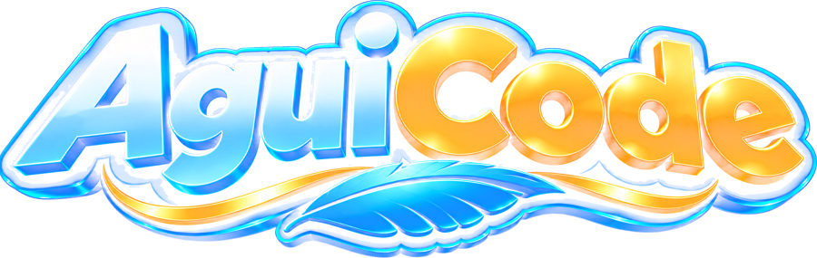

  

  <b>Programación, automatización e IA en español, explicadas por Agui 🦅</b> 
  Aquí vive el código de cada video del canal: listo para clonar, probar y adaptar.

  

---

### 🎬 Videos y repositorios

| # | Video | Repositorio | Tecnologías |
| --- | --- | --- | --- |
| 1 | [n8n desde cero: crea un bot de noticias con IA y Telegram](https://youtu.be/VuJmM_N0J8k) | [n8n-daily-news-bot](https://github.com/AguiCode7/n8n-daily-news-bot) | n8n · OpenAI · Telegram |
| 2 | [API en .NET con Clean Architecture y PostgreSQL + n8n](https://youtu.be/CIM9Qja3Xow) | [aguinews-api](https://github.com/AguiCode7/aguinews-api) | .NET · Clean Architecture · PostgreSQL · n8n |

### 🧰 Con qué trabajamos

  
  
  
  
  
  
  

### 📐 Cómo está hecho el código

- **Clean Architecture** en tres capas: `AC.API`, `AC.Core` y `AC.Infrastructure`.
- Principios **SOLID** y patrones de diseño solo cuando aportan.
- Código en **inglés**, comentarios en **español**.
- **Nada hardcodeado**: configuración y secretos fuera del código.

### 💬 ¿Quieres un tema?

Déjalo en los comentarios de los videos en [YouTube](https://www.youtube.com/channel/UCOwIey0vGlYkZBgF29ASn3A). ¡Suscríbete y nos vemos en el próximo video!
